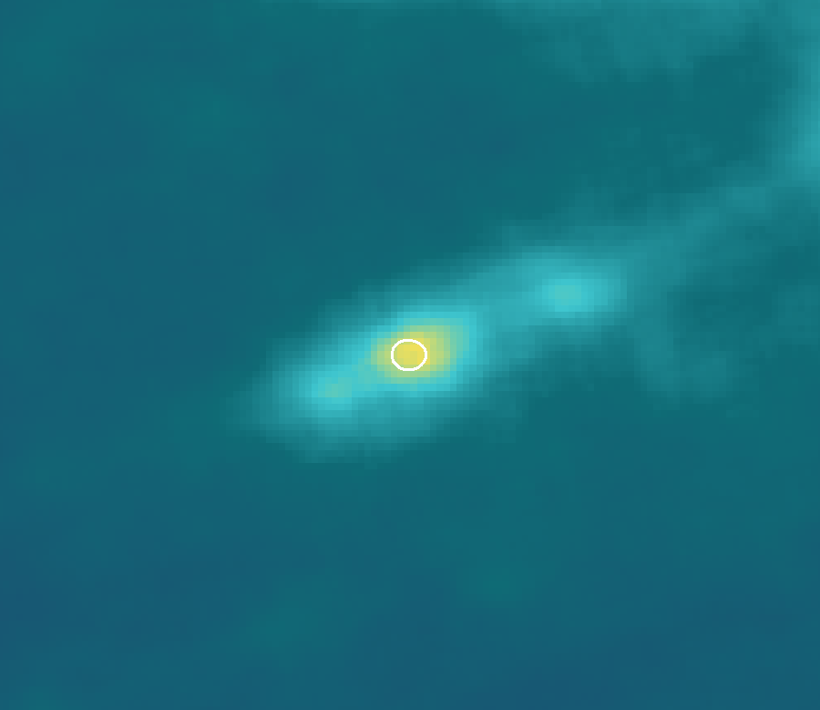
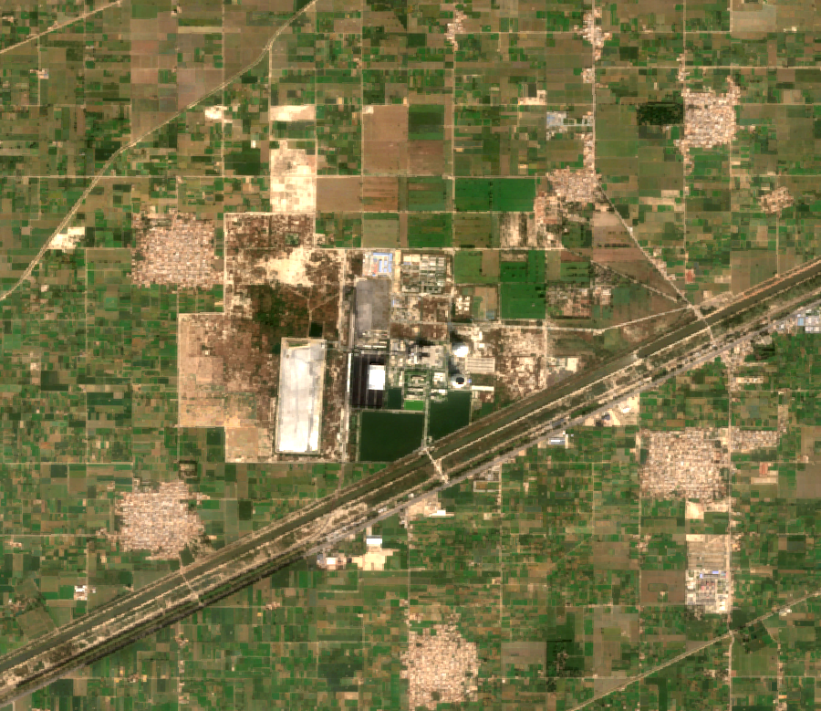

# Satellite Verification of Green Claims

A coal power company tells its bank two things: how much it emits, and how many trees it planted to offset part of that. This project checks both claims from space.

- **Emissions:** Sentinel-5P NO2 around the plant, corrected for wind, turned into an estimate of generation by a model trained on metered plant generation (CPPA-G). CO2 is derived from that, always as a range.
- **Trees:** Sentinel-2 imagery of each offset plot, checked every quarter. Farmers are paid only when the trees are confirmed alive.
- **Answer:** for each claim, CONSISTENT, INCONSISTENT or CANNOT_VERIFY. Impossible or weak inputs are rejected or flagged, never answered with a confident number.

The satellite measures NO2, not CO2. An INCONSISTENT result is a reason to ask questions, not proof of a false statement.

BattleVerse 2026, Iqra University · Battle of Intelligence · Pillar 5: Greenwashing & Disclosure Verification · Challenges C04, C07, C12

## What the satellite sees

| Sentinel-5P NO2 over Sahiwal, 2025 average | Sentinel-2 photo of the plant |
|---|---|
|  |  |
| The plant (white circle) is the hotspot; the plume runs south-west to north-east | Coal yard, ash ponds and the railway line |

## Run it

Needs Python 3.11+.

```bash
pip install -r requirements.txt
streamlit run app/streamlit_app.py     # opens the app on the committed results (the satellite map needs internet for imagery tiles)
```

To rebuild every number from the data, or run the tests:

```bash
python -m verify.build                 # data/ -> outputs/ (about 30 s, no internet needed)
python -m pytest                       # 80 tests, including the 8 C04 guard cases
```

Refreshing the source data needs the internet and, for Earth Engine, a one-time `earthengine authenticate`:

```bash
python scripts/export_overpasses.py --project <your-ee-project>   # Sentinel-5P NO2 + ERA5 wind -> data/raw/overpasses_*.csv
python scripts/export_trees.py --project <your-ee-project>        # tree plots + C07 samples -> data/raw/
python -m verify.labels data/raw/cppa/*.xlsx                      # CPPA-G spreadsheets -> data/raw/generation_monthly.csv
python scripts/fetch_climate_trace.py                             # Climate TRACE benchmark
```

## Results (real data, Sahiwal coal plant)

| What | Result |
|---|---|
| Monthly NO2 plume vs metered generation (27 months) | r = 0.62 |
| Held-out months (Jan–Sep 2026), RMSE | 169.5 GWh/month, r = 0.45, 78% inside the 80% interval |
| **C07** gain over capacity rule of thumb | **61.7%** (RMSE 442.0 → 169.5) |
| **C07** gain over raw NO2 without wind correction | **30.4%** (RMSE 243.5 → 169.5) |
| Annual claims understated by 20% / 40% / 60% caught | 94% / 100% / 100% of 16 rolling windows, 0% false alarms |
| FY2026, each month predicted by a model that never saw it | 5,896 GWh (range 4,967–6,833) vs metered 6,138: 3.9% low |
| Annual error over 16 rolling years (same method) | 7.3% on average, worst 20.2% |
| Strict forward test (train on the past only, last 15 months) | total 15.4% low; single months about 23% off |
| Tree classifier (second C07 test, 575 real test points) | F1 0.891 vs 0.798 for one greenness threshold: 11.6% gain, short of 15% |
| **C04** guard cases | 8 of 8 pass |

Single months are too noisy for a verdict and abstain; verdicts are given per fiscal year, which is what companies disclose. At the Hub site (a mostly idle coastal plant), the signal is weak; we state that as a limit. Full write-up: [docs/CHALLENGES.md](docs/CHALLENGES.md).

## What is real and what is synthetic

| Real | Synthetic or invented (labelled in the app) |
|---|---|
| Sentinel-5P NO2 and ERA5 wind, Jul 2018 – Nov 2026 | Company claims (no public report figure found; built from real metered numbers) |
| Monthly plant generation, Jul 2024 – Sep 2026 (CPPA-G) | Farmers, plots and prices |
| Climate TRACE benchmark | |
| Sentinel-2 readings on the tree plots | |
| C07 tree samples (WorldCover labels + Sentinel-2) | |

Sources, licences and download dates: [evidence_pack.md](evidence_pack.md).

## Docs

- [Design spec](docs/specs/2026-11-11-green-claims-verification-design.md)
- [Build plan](docs/plans/2026-11-11-build-plan.md)
- [Challenges C04, C07, C12](docs/CHALLENGES.md)
- [Pitch brief and jury Q&A](docs/PITCH_BRIEF.md)
- [Glossary: every term in plain words](docs/GLOSSARY.md)
- [Discussion log: every question we settled](docs/DISCUSSION_LOG.md)
- [App design contract](DESIGN.md)

## Team

Muhammad Arham · Baneen Raza · Ayesha Maryam

Tree-verification ideas and Earth Engine scripts adapted from [Shajar Ledger](https://github.com/Baneenraza/Shajar).
